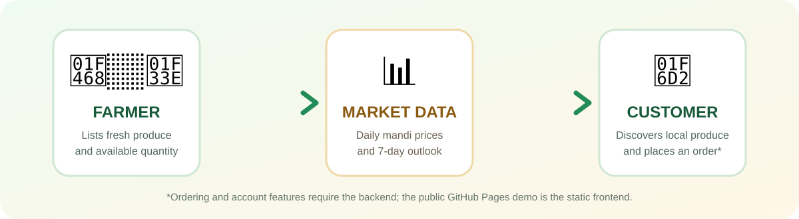
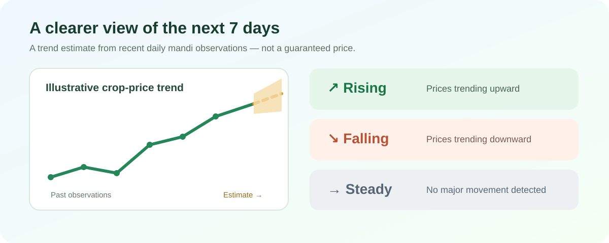
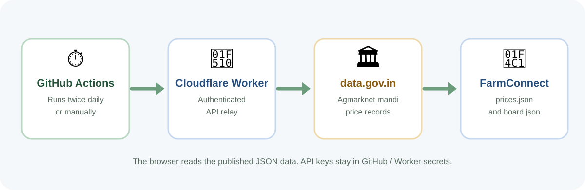

<div align="center">


# 🌾 FarmConnect

### From the farmer's field to the customer's basket — with market prices that help farmers plan.

[**Open the live demo**](https://manishn1877.github.io/Farm-Connect/) · [Report an issue](https://github.com/manishn1877/Farm-Connect/issues) · [Contribute](CONTRIBUTING.md)


</div>

---

## 🌱 What is FarmConnect?

FarmConnect is an open-source farm-to-customer platform concept. It brings local produce listings, market information and farmer-focused price insights into one place.

The goal is simple: make it easier for farmers to understand market movement and connect with customers, while helping customers discover fresh local produce.



## 🧺 Explore the experience

| 🥬 Fresh produce | 👨‍🌾 Farmer tools | 🛍️ Customer experience |
|---|---|---|
| Browse a broad catalogue of fruits, vegetables, greens and staples. | List produce, quantities and prices; view market information and crop outlook. | Discover local produce and browse listings by market. |
| Product photos load from bundled assets where available, with an online fallback. | Farmer account, listing and order features are supported by the Node/SQLite backend. | The complete account and ordering experience requires the backend to be deployed. |

## 📈 The farmer's price forecast

One of FarmConnect's important features is its **7-day mandi price outlook**. It helps a farmer see which supported commodities have recently been moving up, down or staying relatively steady.



### What the forecast shows

- **Rising / falling / steady:** a simple direction label based on the estimated movement over the next seven days.
- **Estimated price range:** a range around the seven-day estimate, rather than a single guaranteed number.
- **Trend chart:** recent market observations followed by a projected line and uncertainty band.
- **Crop search:** look up a supported fruit, vegetable or other tracked commodity.
- **Your crops:** where a farmer's listed products match mandi commodities, the dashboard can highlight those outlooks.

### How the estimate is calculated

The application reads dated price history from `data/prices.json`. It uses up to the latest **21 available observations**, fits a simple linear trend, and projects the next **7 days**. At least **3 dated observations** are needed before a forecast is displayed.

> **Please use forecasts as guidance, not a promise.** This is currently a simple statistical trend estimate, not a trained machine-learning model. It does not yet model weather, crop arrivals, transport costs, festivals, local demand or sudden market disruptions. Always compare the outlook with current local mandi prices and your own costs before deciding when to sell.

**Where it is available:** the forecast interface is implemented in the root `index.html` used by the GitHub Pages demo. The separate `server/public/index.html` backend-served frontend has not yet been brought to the same forecast-interface feature parity.

## 📊 Official Karnataka mandi prices

FarmConnect collects daily wholesale market prices for Karnataka from the Government of India's Open Government Data Platform, using the Agmarknet resource:

**Current Daily Price of Various Commodities from Various Markets (Mandi)**

The automated workflow refreshes the data twice daily:

- **11:10 AM IST**
- **7:10 PM IST**

It can also be started manually from **GitHub → Actions → Update daily mandi prices → Run workflow**.



### Data files

| File | What it contains |
|---|---|
| `data/prices.json` | Aggregated commodity prices and dated history used by the application. |
| `data/board.json` | Market / board-level price records used for market information. |

### Secure API relay

A Cloudflare Worker relays requests from GitHub Actions to `data.gov.in`. It checks a shared relay token, uses a fixed upstream endpoint and restricts allowed query parameters. It is **not an open proxy**.

The API key and relay token are stored as secrets — never commit them or paste them into screenshots.

Required repository Actions secrets:

- `DATA_GOV_API_KEY`
- `FC_RELAY_URL`
- `FC_RELAY_TOKEN`

Deployment, configuration, testing and troubleshooting instructions: [`relay/README.md`](relay/README.md).

## 🧰 Built with

| Area | Technology |
|---|---|
| Frontend | HTML, CSS and JavaScript |
| Backend | Node.js |
| Database | SQLite |
| Market data | Government of India data.gov.in / Agmarknet |
| Scheduled updates | GitHub Actions |
| Secure API relay | Cloudflare Workers |
| Static hosting | GitHub Pages |

## 🚀 Try FarmConnect

### Live website

Visit **[manishn1877.github.io/Farm-Connect](https://manishn1877.github.io/Farm-Connect/)**.

The GitHub Pages deployment is the static frontend. It can display the site and published mandi data, but GitHub Pages does not run the Node server. Login, persistent farmer/customer data and live order handling require the backend.

### Run the frontend locally

```bash
git clone https://github.com/manishn1877/Farm-Connect.git
cd Farm-Connect
python -m http.server 8000
```

Open `http://localhost:8000` in your browser.

### Run the backend

Requires a current [Node.js](https://nodejs.org/) LTS release.

```bash
git clone https://github.com/manishn1877/Farm-Connect.git
cd Farm-Connect/server
npm install
node server.js
```

See `GUIDE.txt` and the `server/` directory for additional configuration.

## 🗂️ Project map

```text
Farm-Connect/
├── index.html                 # GitHub Pages frontend + price forecast
├── produce/                   # Produce catalogue and image tools
├── server/                    # Node.js + SQLite backend
├── data/
│   ├── prices.json            # Aggregated mandi prices and history
│   └── board.json              # Board-level market data
├── scripts/
│   └── fetch_prices.py         # Fetches and processes official prices
├── relay/
│   ├── worker.js               # Authenticated Cloudflare relay
│   ├── wrangler.toml           # Worker deployment configuration
│   └── README.md               # Relay guide
├── docs/
│   └── images/                 # README illustrations
└── .github/workflows/          # Automation and deployment workflows
```

## 🤝 Contribute

Ideas, bug reports, translations, design improvements and code contributions are welcome.

1. Read [`CONTRIBUTING.md`](CONTRIBUTING.md).
2. Browse [open issues](https://github.com/manishn1877/Farm-Connect/issues).
3. Create a branch, make your change and open a pull request.

## 📜 License

FarmConnect is released under the [MIT License](LICENSE).

<div align="center">

### Built to bring farmers, markets and customers closer.

**[Explore FarmConnect](https://manishn1877.github.io/Farm-Connect/)** · **[View the source on GitHub](https://github.com/manishn1877/Farm-Connect)**

</div>
